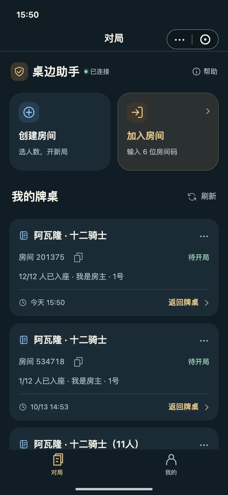
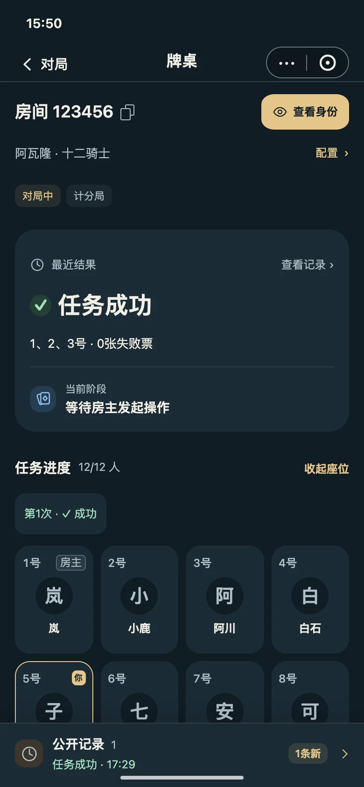
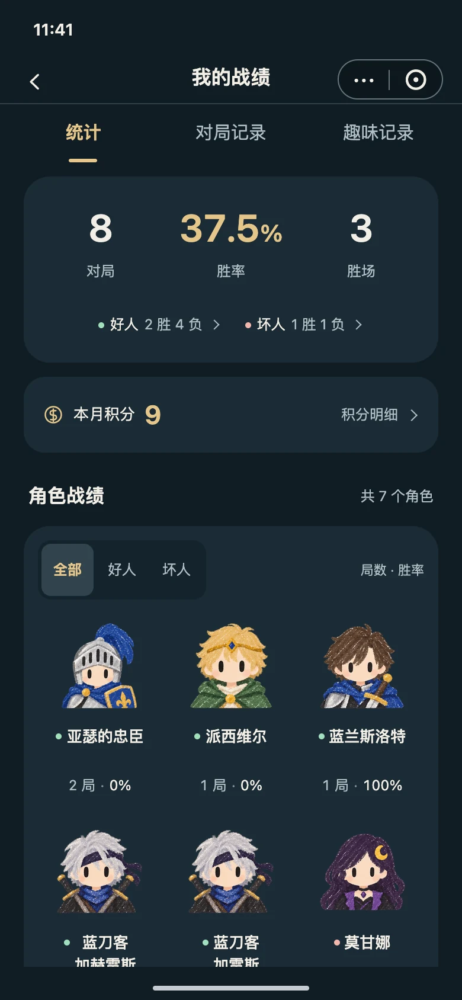

<p align="center">
  
</p>

<h1 align="center">桌边助手 · ShadowTable</h1>

<p align="center"><strong>线下讨论，线上发牌。</strong></p>
<p align="center">为阿瓦隆聚会准备的桌游助手：私密身份、秘密投票、任务与技能结算，以及每一局之后的战绩与复盘。</p>
<p align="center">微信小程序 / 网页版 · 5–13 人 · 6 类玩法 · Node.js + SQLite</p>

<p align="center">
  <a href="#快速上手">快速上手</a> ·
  <a href="#功能亮点">功能亮点</a> ·
  <a href="#支持的玩法">支持的玩法</a> ·
  <a href="#本地开发">本地开发</a> ·
  <a href="#部署与发布">部署与发布</a> ·
  <a href="#项目文档">项目文档</a>
</p>

## 界面预览

<table>
  <tr>
    <th align="center">牌桌大厅</th>
    <th align="center">对局操作</th>
    <th align="center">战绩统计</th>
  </tr>
  <tr>
    <td width="33%"></td>
    <td width="33%"></td>
    <td width="33%"></td>
  </tr>
</table>

预览使用当前小程序 WXML / WXSS 模板与示例数据生成，微信原生组件的实际表现以真机为准。

## 快速上手

<p align="center">
  
  <br>
  <sub>微信扫码，创建或加入牌桌</sub>
</p>

1. **组一桌**：房主选择人数与板子，朋友通过邀请或 6 位房间码加入。
2. **入座发牌**：选择座位并准备；满座且全员准备后，房主发牌，每人在自己的手机上查看身份与初始视野。
3. **面对面玩**：线下讨论，房主按现场进度发起投票、任务或技能；提交收齐后自动结算。
4. **结算再开**：线下完成最终盘刀，由房主登记结果或选择“不计战绩”；同一牌桌可以重新准备，再开一局。

准备阶段可换座或站起围观；满座、游戏进行中及本局结束后，新成员均可加入旁观，重开后再手动入座。切换牌桌或返回大厅会保留当前座位。

> **按现场节奏使用。** 系统辅助发牌与操作结算，整局由房主手动结束。三次任务成功／失败、连续否决或单次技能结果不会自动结束整局；最终刀梅林在线下进行。

## 功能亮点

| 场景                 | 可以做什么                                                                                                           |
| -------------------- | -------------------------------------------------------------------------------------------------------------------- |
| **私密身份与视野**   | 主动揭示身份、初始互认与技能视野；小程序进入后台后遮盖私密内容，房主也不能查询全员身份或秘密提交。                   |
| **投票、任务与技能** | 按需发起操作，查看提交进度，收齐后自动结算；任务支持选择队员与失败票门槛，十二骑士支持同时技能、换牌与复活。         |
| **多人多桌**         | 邀请好友、旁观、换座、房主转交、同房重开；恢复牌桌、个人备注与左滑管理让多桌切换更方便。                             |
| **战绩与复盘**       | 按时间、板子、角色和胜负筛选对局；按阵营与角色查看统计，回看分轮过程、初始／最终身份及身份变化轨迹。                 |
| **积分与荣誉**       | 月度积分、明细流水、排行榜、趣味记录、MVP / SVP 票选与 18 枚月榜荣誉徽章；月度战报与排行榜成绩可生成分享图片。       |
| **个人资料与回避卡** | 160 款内置头像，可选开启自定义上传；发牌前用回避卡选择不想抽到的角色，实际避开才扣卡，支持管理员发放与累计胜负奖励。 |
| **开发与自部署**     | 原生微信小程序、网页版玩家入口、本地陪测面板和可选管理平台，共用单体 Node.js 服务与 SQLite。                         |

详细使用方式、战绩统计口径与隐私约定见 [玩家指南](docs/player-guide.md)。

## 支持的玩法

| 玩法     | 人数                  | 线上支持范围                                                                                       | 线下完成的部分           |
| -------- | --------------------- | -------------------------------------------------------------------------------------------------- | ------------------------ |
| 经典基础 | 5、6、7、8、9、10、12 | 身份与初始视野、投票、任务；12 人含双奥伯伦                                                        | 最终盘刀与整局结算确认   |
| 逆仆     | 9、11                 | 经典操作、刀逆仆及私密阵营变化                                                                     | 匪队决策与最终盘刀       |
| 红蓝兰斯 | 11、12                | 红蓝兰斯阵营转换、当前红兰强制失败；12 人增加奥伯伦                                                | 最终盘刀                 |
| 影中执刃 | 12                    | 身份、初始互认、投票与任务                                                                         | 特殊盘刀与最终胜负       |
| 混沌契约 | 12                    | 身份、初始互认、魔法票与盗贼失败票结算                                                             | 首夜绑定、特殊盘刀与排名 |
| 十二骑士 | 10、11、12、13        | 同时秘密技能、守护／换号／替死、猎人预选开枪、圣骑士反伤、石像鬼查验、B 牌复活、身份转换与视野更新 | 最终盘刀与整局结算确认   |

- **湖中仙女**：各板子共用设置，5、6 人不支持，7 人默认关闭，8 人及以上默认开启；查验结果仅本人可见。
- **十二骑士 13 人局**：在 12 人局 A 牌中增加一名忠臣，其余规则沿用 12 人局。板子详情支持 A / B 牌组切换及角色、技能搜索。
- **计分范围**：经典基础 5–10、12 人及十二骑士 10–13 人；9、11 人逆仆与其他扩展板暂不计分。十二骑士默认开启计分，其他板子默认关闭，房主可在发牌前设置。

完整配置与技能说明见 [规则说明](docs/rules.md)，分值与计分条件见 [积分系统](docs/scoring.md)。规则文档保留了演进记录，同一事项以靠后的最新补充为准。

## 本地开发

### 1. 启动服务

需要 **Node.js ≥ 22.13.0** 和 npm。项目使用内置 `node:sqlite`，生产镜像使用 Node 24；无需 Redis 或消息队列。

```sh
npm ci
npm run dev
```

默认数据库为 `data/shadowtable.sqlite`。开发命令同时启用开发登录、本地陪测和网页版：

| 入口     | 地址                           | 用途                                     |
| -------- | ------------------------------ | ---------------------------------------- |
| 网页版   | <http://127.0.0.1:8787/>       | 直接在浏览器创建、加入牌桌               |
| 本地陪测 | <http://127.0.0.1:8787/dev>    | 补齐测试玩家，验证发牌、投票、任务与技能 |
| 健康检查 | <http://127.0.0.1:8787/health> | 检查服务状态                             |

开发登录每次新登录生成独立身份，清除会话后无法恢复。测试多名玩家时，可使用独立浏览器存储环境或陪测面板；陪测只操作独立测试账号，不代替真人提交。

### 2. 运行微信小程序

1. 在微信开发者工具中导入**项目根目录**，工具会读取 `project.config.json`；自部署时将仓库 AppID 替换为自己的 AppID。
2. 将 [miniprogram/config.js](miniprogram/config.js) 中的配置切换为本地开发值：

   ```js
   module.exports = {
     baseUrl: "http://127.0.0.1:8787",
     devAuth: true,
   };
   ```

3. 在开发者工具的本地设置中关闭 request 合法域名校验，编译运行。
4. 创建牌桌后，在 `/dev` 输入房间码、补齐测试玩家并全部准备，再回到小程序开局。

真机同网调试时，将 `baseUrl` 改为电脑的局域网地址，并使用以下命令监听局域网：

```sh
HOST=0.0.0.0 npm run dev
```

手机上的 `127.0.0.1` 指向手机本身。本地陪测面板仍仅允许电脑本机访问，且必须同时开启 `DEV_AUTH=1`、`DEV_PANEL=1`；生产环境不可用。

### 3. 检查与测试

```sh
npm test          # Node.js 自动化测试
npm run check    # 主要服务端与客户端脚本语法检查
```

CI 还会检查部署脚本与容器流程；自动化覆盖及需要真机验收的范围见 [验证记录](docs/verification.md)。

### 目录结构

```text
miniprogram/       原生微信小程序、共享展示逻辑与静态资源
server/           HTTP API、规则引擎与 SQLite 存储
  web/            网页版玩家入口
  dev-panel/      本地陪测面板
  admin/          正式管理平台
tests/            自动化测试与测试数据
scripts/          页面预览、素材导入等开发工具
deploy/cloud/     容器部署、预检与回退脚本
docs/             玩家指南、规则、架构、部署与预览图片
```

## 部署与发布

服务端采用**单实例 Node.js + SQLite**，通过 Docker Compose 部署，由独立 Caddy 网关提供 HTTPS。推送 `main` 后，GitHub Actions 执行验证并构建镜像；在 **Deploy tested image** 中手动选择目标与已验证的构建发布，健康检查失败时回退应用镜像。

服务器初始化、镜像仓库、Secrets 与发布步骤见 [部署指南](docs/deployment.md)。环境变量示例见 [.env.example](.env.example) 与 [容器配置](deploy/cloud/app.env.example)。

| 配置                                  | 用途                                                                         |
| ------------------------------------- | ---------------------------------------------------------------------------- |
| `WECHAT_APP_ID` / `WECHAT_APP_SECRET` | 小程序服务端微信登录凭据                                                     |
| `HOST` / `PORT`                       | 监听地址与端口，默认 `127.0.0.1:8787`                                        |
| `DB_PATH`                             | SQLite 文件路径，默认 `data/shadowtable.sqlite`                              |
| `WEB_ORIGIN`                          | 启用网页版与游客登录，生产使用完整 HTTPS 源地址                              |
| `WECHAT_WEB_LOGIN`                    | 可选的小程序扫码确认网页登录，默认关闭，见 [扫码登录说明](docs/web-login.md) |
| `ADMIN_ORIGIN` / `ADMIN_KEY`          | 同时配置后启用 `/admin` 管理平台                                             |
| `DEV_AUTH` / `DEV_PANEL`              | 开发登录与本地陪测开关，生产均设为 `0`                                       |

直接通过 Node 启动生产服务的示例（其余配置由运行环境注入）：

```sh
NODE_ENV=production DEV_AUTH=0 DEV_PANEL=0 PORT=8787 npm start
```

发布时按以下顺序检查：

1. **配置与备份**：Node 不会自动读取 `.env`，由运行环境或 Compose 注入配置；SQLite 仅允许一个服务实例写入，使用在线备份或停服备份完整数据目录。
2. **部署服务端**：先备份再更新镜像，确认健康检查通过；网页版随服务端更新。自动回退仅恢复应用镜像，不恢复数据库。
3. **发布小程序**：配置自己的 AppID、HTTPS `baseUrl` 和 request 合法域名，将客户端 `devAuth` 设为 `false`，AppSecret 仅保留在服务端。
4. **验收客户端**：检查登录、发牌与结算；在微信开发者工具确认主包／分包体积。资料编辑页及 160 张头像位于普通分包，资源已纳入服务端镜像。

服务内置每日本机在线备份与数据保留策略；自动清理要求最近 48 小时内存在已校验备份，历史战绩、积分和进行中牌局保留。管理平台支持房间管理、正式陪测、战绩更正、积分与回避卡管理及操作审计。详见 [维护说明](docs/operations.md)。

## 项目文档

| 想了解什么                     | 文档                                                                                                        |
| ------------------------------ | ----------------------------------------------------------------------------------------------------------- |
| 牌桌操作、旁观、个人资料与隐私 | [玩家指南](docs/player-guide.md)                                                                            |
| 角色配置、技能与扩展板规则     | [规则说明](docs/rules.md) · [待确认项](docs/rule-questions.md) · [规则原文](docs/sources/custom-boards.txt) |
| 计分条件、月度积分与后台更正   | [积分系统](docs/scoring.md)                                                                                 |
| 趣味指标、票选与荣誉徽章       | [趣味记录](docs/fun-records.md) · [月榜荣誉徽章](docs/honor-badges.md)                                      |
| 月度统计与分享长图             | [月度战报](docs/monthly-report.md)                                                                          |
| 网页与小程序使用同一账号       | [扫码登录说明](docs/web-login.md)                                                                           |
| 开启自定义头像与审核           | [自定义头像](docs/avatar-uploads.md)                                                                        |
| 服务结构、数据模型与接口       | [架构与协议](docs/architecture.md)                                                                          |
| 部署、发布、备份与恢复         | [部署指南](docs/deployment.md) · [维护说明](docs/operations.md)                                             |
| 自动化覆盖与真机验收           | [验证记录](docs/verification.md)                                                                            |

## 许可证

本项目原创代码采用 [MIT License](LICENSE)，允许商业使用、修改和分发，使用时须保留版权及许可声明。第三方依赖、引用的规则文档、图片及其他第三方素材的权利归各自权利人所有，不因本项目的 MIT 许可而重新授权。
