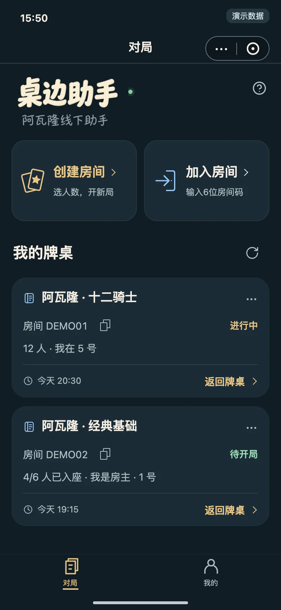
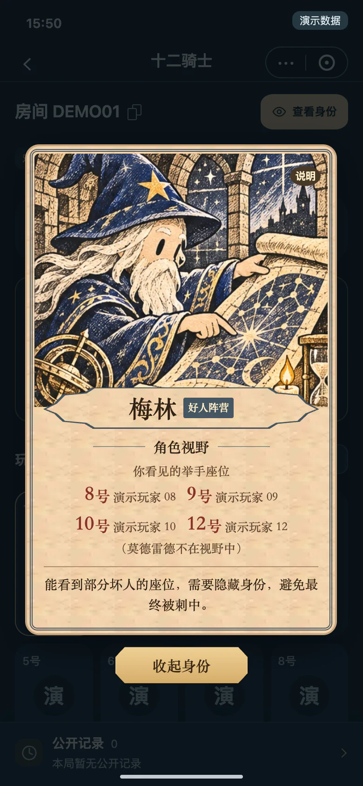
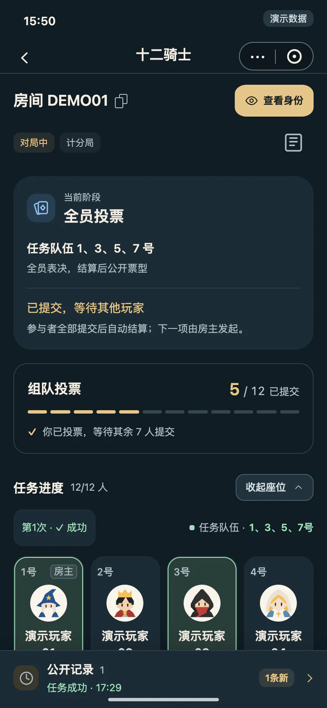
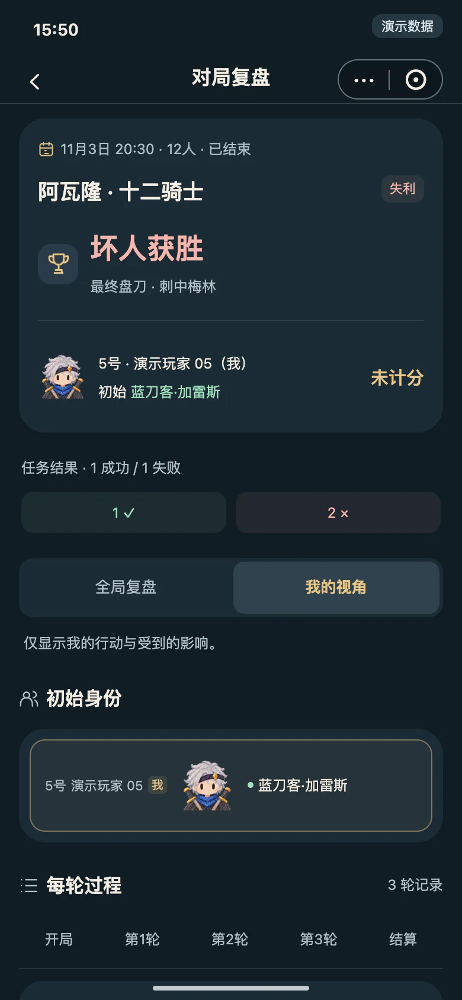
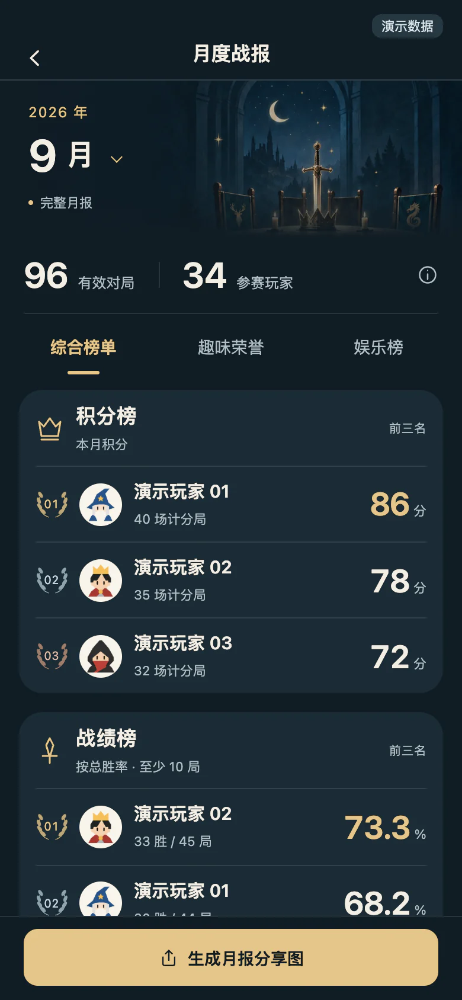
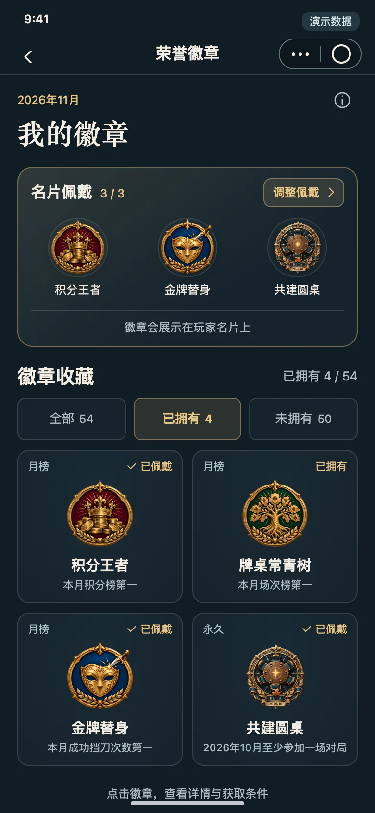

<p align="center">
  
</p>

<h1 align="center">桌边助手 · ShadowTable</h1>

<p align="center"><strong>面对面玩阿瓦隆，用手机发身份牌、投票、出任务。</strong><br>
支持 5–13 人、6 类玩法。微信小程序和网页版可以加入同一张牌桌，散场后还能逐轮复盘。</p>

<p align="center">
  <a href="#快速上手">微信扫码开桌</a> ·
  <a href="#界面预览">看一局怎么玩</a> ·
  <a href="#支持的玩法">按人数选板子</a> ·
  <a href="#本地开发">本地运行</a> ·
  <a href="#部署与发布">自部署</a>
</p>

## 快速上手

<p align="center">
  
  <br><sub>用微信扫码，或打开朋友发来的牌桌邀请</sub>
</p>

1. **开桌入座**　房主选择人数和板子，朋友通过邀请或 6 位数字房间码加入，各自选座并准备。满座且全员准备后，房主发牌。
2. **看牌讨论**　轻点牌面，查看自己的角色、阵营和可见座位。收起身份牌后，继续面对面发言。需要时可在牌桌上再次查看身份。
3. **投票出任务**　房主按现场进度发起组队投票、任务或技能。每人在手机上秘密提交，房主可查看哪些座位尚未提交。组队投票结算后公开票型，任务只公布汇总结果。
4. **结算或再开**　最终盘刀在线下完成，由房主在「结束本局」登记结果，也可以选择「不计战绩」。同桌重新准备就能再开一局，已记录的对局可在「我的」查看。

中途到场的朋友可以旁观。返回大厅或切换牌桌会保留座位。换座、转交房主、提前结束等待等操作见[玩家指南](docs/player-guide.md)。

## 界面预览

下图用小程序当前页面模板和虚构数据生成。点击图片可放大查看。

| 大厅 · 创建或返回牌桌 | 身份牌 · 查看梅林视野 | 牌桌 · 等待组队投票 |
| :---: | :---: | :---: |
| [](docs/images/preview-lobby.webp) | [](docs/images/preview-identity.webp) | [](docs/images/preview-table.webp) |

<details>
<summary>展开查看个人复盘、月度战报与荣誉收藏</summary>

| 对局复盘 · 我的视角 | 月度战报 · 积分榜 | 荣誉徽章 · 名片佩戴 |
| :---: | :---: | :---: |
| [](docs/images/preview-replay.webp) | [](docs/images/preview-monthly.webp) | [](docs/images/preview-badges.webp) |

还可以按阵营和角色查看自己的胜率。[查看个人战绩截图](docs/images/preview-stats.webp)

</details>

## 支持的玩法

| 玩法 | 人数 | 这桌可以怎么玩 |
| --- | --- | --- |
| 经典基础 | 5–10、12 | 私密发牌与初始视野、组队投票、任务出牌。12 人局含双奥伯伦。 |
| 逆仆 | 9、11 | 线下决策，三绿后房主依次登记逆仆刀和梅林刀，系统据此结算。 |
| 红蓝兰斯 | 11、12 | 跟踪两名兰斯洛特的阵营转换，按当前阵营执行红兰强制失败规则。12 人局增加奥伯伦。 |
| 影中执刃 | 12 | 线上处理身份、互认、投票与任务，特殊盘刀和最终胜负由同桌在线下决定。 |
| 混沌契约 | 12 | 线上结算魔法票和盗贼失败票，首夜绑定、特殊盘刀与排名在线下完成。 |
| 十二骑士 | 10–13 | 支持同时秘密发动技能、换号、替死、阵营转换、B 牌复活及视野更新。13 人局在 12 人 A 牌中增加一名忠臣。 |

**湖中仙女**可在 7 人局手动开启，8 人及以上默认开启。查验结果仅本人可见。**本局计分**在发牌前设置，十二骑士默认开启，经典基础、逆仆和红蓝兰斯可手动开启。各人数的角色配置、技能时序及计分条件见[规则说明](docs/rules.md)和[积分系统](docs/scoring.md)。

## 功能亮点

- **个人战绩与复盘**　按时间、板子、角色或胜负筛选对局。复盘可切换全局和个人视角，回看组队票型、任务结果与身份变化。个人数据管理支持按月预览并清除自己的记录。
- **积分与公开榜单**　公开排行榜和月报中的榜单只统计开局时 **9 人及以上**的有效对局。5–8 人局仍可留下个人战绩，符合计分条件时也可获得个人积分。
- **荣誉与分享**　赛后可票选 MVP / SVP，分享个人战绩或生成完整月报长图。月榜徽章随排名更新，自 2026 年 11 月榜起，积分月榜前三名另获当月的永久徽章。玩家名片最多佩戴 3 枚。
- **回避卡与个人资料**　发牌前可用回避卡选择一个不想抽到的初始角色，实际避开才扣卡。可从 160 款内置头像中选择，服务端也可开启自定义头像上传。
- **问题反馈**　小程序「我的 → 反馈与建议」可报告问题或提出功能建议，最多附 4 张截图。在「我的反馈」里可以查看处理进度和管理员回复。

## 本地开发

需要 **Node.js ≥ 22.13.0** 和 npm。数据库使用 Node 内置的 SQLite，CI 和生产镜像使用 Node 24。在项目根目录运行以下命令即可启动网页版和陪测面板。

```sh
npm ci
npm run dev
```

| 本机入口 | 用途 |
| --- | --- |
| [网页版](http://127.0.0.1:8787/) | 以游客身份创建或加入牌桌。 |
| [陪测面板](http://127.0.0.1:8787/dev) | 输入房间码，补齐测试玩家、准备并代这些测试账号提交操作。 |
| [健康检查](http://127.0.0.1:8787/health) | 确认服务已启动。 |

默认数据库为 `data/shadowtable.sqlite`。一个人试跑时，可先在网页版创建房间，到陪测面板补齐玩家，再回到房主页面发牌。

### 连接微信开发者工具

1. 导入**项目根目录**，让开发者工具读取 `project.config.json`。自部署时使用自己的小程序 AppID。
2. 编辑客户端配置，将 `baseUrl` 设为 `http://127.0.0.1:8787`、`devAuth` 设为 `true`。[小程序配置文件](miniprogram/config.js)
3. 在开发者工具的本地设置中关闭 request 合法域名校验，重新编译。真机同网调试时用 `HOST=0.0.0.0 npm run dev` 启动，并把 `baseUrl` 中的地址替换成电脑的局域网 IP。陪测面板仍在电脑本机打开。

### 检查与测试

```sh
npm run check   # 服务端和小程序脚本语法检查
npm test        # 游戏规则、API、客户端等自动化测试
```

<details>
<summary>重新生成 README 截图素材</summary>

在项目根目录运行以下命令，从小程序模板生成带演示数据的 HTML。

```sh
preview_dir=output/playwright/readme
node scripts/render-core-pages-preview.js "$preview_dir/core"
node scripts/render-stats-preview.js "$preview_dir/stats"
node scripts/render-monthly-preview.js "$preview_dir/monthly"
node scripts/render-badges-preview.js "$preview_dir/badges"
```

大厅、梅林身份牌、组队投票和复盘分别取自 `core/readme-lobby.html`、`core/readme-identity.html`、`core/readme-table.html`、`core/readme-replay.html`。战绩、月报和徽章取自对应子目录的 `readme.html`。本机静态预览需能读取 `/miniprogram/` 下的月报素材。以 390 × 844 视口、2 倍像素密度截图，标注「演示数据」，将 WebP 保存至 `docs/images/`。

</details>

## 部署与发布

服务端以**单实例 Node.js + SQLite** 运行。仓库提供 Docker Compose 部署脚本，HTTPS 由独立 Caddy 网关提供。

1. **配置环境**　小程序微信登录需要服务端的 `WECHAT_APP_ID` 和 `WECHAT_APP_SECRET`。启用网页版需配置 `WEB_ORIGIN`，启用管理平台需同时配置 `ADMIN_ORIGIN` 和 `ADMIN_KEY`。生产将 `DEV_AUTH`、`DEV_PANEL` 设为 `0`。环境变量由运行环境或 Compose 注入。[环境变量示例](.env.example) · [容器配置示例](deploy/cloud/app.env.example)
2. **发布服务端**　推送到 `main` 后，GitHub Actions 验证并构建镜像。在 **Deploy tested image** 中选择目标和已通过的构建。发布前备份 SQLite，健康检查失败时流程回退应用镜像，数据库恢复使用备份。[部署指南](docs/deployment.md) · [备份与恢复](docs/operations.md)
3. **发布小程序**　将客户端切回 HTTPS 服务地址和 `devAuth: false`，配置微信 request 合法域名，在开发者工具核对分包体积并用真机验证登录、发牌和结算。网页版随服务端更新。若需让浏览器沿用小程序账号，再启用扫码确认登录。[扫码登录配置](docs/web-login.md)

## 项目文档

| 主题 | 文档 |
| --- | --- |
| 牌桌操作、旁观、隐私与个人数据 | [玩家指南](docs/player-guide.md) · [按月清除个人战绩](docs/player-guide.md#按月清除个人战绩) · [自定义头像](docs/avatar-uploads.md) |
| 角色与玩法 | [规则说明](docs/rules.md) · [待确认项](docs/rule-questions.md) · [规则原文](docs/sources/custom-boards.txt) |
| 计分、荣誉与月报 | [积分系统](docs/scoring.md) · [趣味记录](docs/fun-records.md) · [荣誉徽章](docs/honor-badges.md) · [月度战报](docs/monthly-report.md) |
| 开发与运维 | [架构与协议](docs/architecture.md) · [部署指南](docs/deployment.md) · [维护说明](docs/operations.md) · [验证记录](docs/verification.md) |

## 许可证

原创代码采用 MIT 许可，允许商业使用、修改和分发，使用时须保留版权及许可声明。第三方依赖、规则文档和图片等素材的权利归各自权利人所有，适用各自的授权条件。[MIT License](LICENSE)
